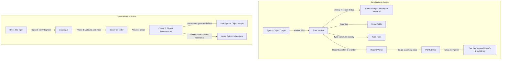

# Rust Engine & PyO3 Architecture

`pysafe-pickle` is built as a compiled Rust cdylib extension module (`_pysafe_pickle`) using PyO3 and Maturin.

The Rust source is small and split by responsibility:

| File | Role |
| :--- | :--- |
| `src/lib.rs` | PyO3 module: `dumps`, `loads`, `dump`, `load` and the internal `_loads_prefix` (used by `Unpickler`), bytes-like input handling, HMAC key validation, GIL release for large inputs, file positioning after `load` |
| `src/errors.rs` | Raises the package's Python exception classes (`UnsafeTypeError`, `DecodeError`, `HMACError`) from Rust, importing them once from `pysafe_pickle.exceptions` and falling back to `TypeError`/`ValueError` if that import fails |
| `src/integrity.rs` | HMAC-SHA256 signing (`sign`), constant-time verification, and `decode_one`, which frames one payload in a buffer and verifies its tag before decoding |
| `src/graph/traversal.rs` | `Walker`: breadth-first object-graph traversal that assigns record IDs and emits records; type dispatch for dataclasses, namedtuples, enums and the stdlib types |
| `src/format/mod.rs` | Tag enum (38 tags), header constants and flags, `defaultdict` factory codes, little-endian and zigzag-varint helpers |
| `src/format/encoder.rs` | `RecordWriter`: string table, type table, record buffer and final assembly into a `bytes` object |
| `src/format/decoder.rs` | Two-phase decoder: validation into a compact index, then object reconstruction (including `classes=` resolution and migrations) |

Python-side helpers live in `python/pysafe_pickle/`: `_reconstruct.py` (generated classes, `classes=` validation, dataclass defaults, namedtuple and enum construction), `migrations.py`, `pickler.py` (`Pickler`/`Unpickler`), `exceptions.py`, and `compat.py`, the pure-Python safe reader for standard pickle data (see [Pickle Compatibility](/api/pickle-compat)).

---

## High-Level Pipeline

---

## 1. Breadth-First Object Traversal (`traversal.rs`)

The `Walker` traverses the Python object graph breadth-first using a work queue:

- **Record IDs are assigned up front.** When a container is written, each child is passed through `assign`, which returns the child's record ID immediately (allocating a new ID and queueing the child if it has not been seen). Records are then written straight into the output buffer in ID order, so no intermediate record tree is ever built. The root is always record 0.
- **Shared and cyclic objects reuse the existing ID.** Non-scalar objects are memoized by identity (address -> record ID) and pinned with a strong reference for the duration of the call so an address can never be reused by a different object. A parent that reaches an already-seen object simply stores that object's record ID. The encoder does **not** emit `Reference` (`0x0E`) records; the tag is only kept so the decoder can read legacy payloads.
- **Scalars are deduplicated by value.** One record each for `None`, `True` and `False`; one record per distinct string (strings under 4096 bytes are interned by value); ints and floats go through a small direct-mapped cache (floats keyed by bit pattern). Ints outside the `i64` range become `BigInt`, strings that are not strict UTF-8 become `StrRaw`.
- **Large payloads are not copied twice.** `bytes` and `str` objects of 4096 bytes or more are referenced in place and copied once, during final assembly, straight into the result `bytes` object.
- **Classes.** For each Python type, the walker decides once (and caches in a bounded process-wide cache) whether it is one of the exact stdlib types, an `Enum` class, a namedtuple class (a tuple subclass with a `_fields` tuple of strings), or a dataclass. Dataclass metadata includes the field names from `dataclasses.fields()` and the schema version. Each dataclass, enum and namedtuple type is registered once per call in the type table, keyed by name *and* field list, so same-named classes with different fields get distinct type IDs.
- **Stdlib types** are matched by exact type, so subclasses are rejected. `datetime`/`time` values reference their `tzinfo` as a separate record (shared between values), which must be a `timezone` or `ZoneInfo`. A `defaultdict` factory must be one of the builtin types listed in the format spec. Enum members are written by name, or by value when the name does not look the member up again (composite `Flag` values).
- **Depth limit.** Traversal depth is capped at the interpreter recursion limit; deeper structures raise `RecursionError` instead of overflowing the native stack.
- **Unsupported types.** Anything else (modules, functions, arbitrary class instances, subclasses of built-ins, ...) raises `UnsafeTypeError: Unsupported type: <name>` (a `TypeError`) before any bytes are produced. `errors.rs` converts the walker's internal `TypeError` into `UnsafeTypeError`. Nothing is serialized by calling `__reduce__` or similar hooks.

---

## 2. Writer and Output Assembly (`encoder.rs`)

- The string table and the record section are accumulated in separate buffers and stitched together once, directly into a freshly allocated Python `bytes` object (header, string table, type table, record count, records).
- Writer and walker scratch buffers are recycled per thread (up to a size cap), so repeated `dumps` calls avoid regrowing large allocations.
- The GIL is released only for the final assembly copy, and only when the output is 8 MiB or larger.
- Exceeding the format limits (more than 2^32-1 records or strings, 65535 types, or oversized containers/blobs) raises `ValueError`.
- With `hmac_key`, `lib.rs` hands the finished payload to `integrity::sign`, which sets flag bit 0 and appends the 32-byte HMAC-SHA256 tag (with the GIL released for payloads of 64 KiB or more).

---

## 3. Two-Phase Decoder (`decoder.rs`)

**Framing and HMAC: `integrity::decode_one` (pure Rust).** Every load goes through `decode_one`, which returns the validated index plus the number of bytes the payload occupies (so streams can continue after it). For a signed payload with a key, it first tries the tag in the last 32 bytes and verifies it before parsing; otherwise it scans the structure to find where the records end and verifies the tag there. Key/flag mismatches are reported as `HMACError` before any Python object exists.

**Phase 1: `decode` (pure Rust).** Validates the whole payload once and builds a compact index with one small fixed-size entry per record. Strings stay as slices of the input; container children are not copied but re-read lazily from the input during phase 2. Every count is checked against the number of bytes remaining (so a forged count cannot trigger a huge allocation), and every record, string and type reference is bounds-checked, so phase 2 never sees an invalid index. It also counts how many times each record is referenced. The legacy `PYGR` magic and legacy `Reference` records are still accepted. Failures become `DecodeError`.

**Phase 2: `reconstruct` (needs the GIL).** Builds Python objects with an explicit frame stack rather than native recursion, bounded by the interpreter recursion limit (`RecursionError` beyond it).

- Only records referenced more than once are memoized.
- Shared lists, dicts, sets, `OrderedDict`/`defaultdict`/`Counter`, `deque`s and dataclass instances are created and memoized *before* their children are decoded, so DAGs and cycles are rebuilt faithfully. Immutable values (tuples, frozensets, namedtuples, `Fraction`, `range`, `slice`, enum members) are built after their children; a cycle through one raises `DecodeError`.
- **Type resolution:** each type-table entry is resolved at most once per `loads` call. If its name is in the caller's `classes=` mapping, that class is used after a kind check (dataclass, namedtuple or `Enum`). Otherwise dataclasses use a class generated by `pysafe_pickle._reconstruct.make_class` (same class for the same `(name, field names)`, with a bounded process-wide cache on the Rust side), namedtuples use a validated generated `collections.namedtuple`, and enums raise `UnsafeTypeError`.
- **Dataclass reconstruction:** the instance is created first with `object.__new__(cls)` (no `__init__` call, pickle semantics), then each field is set with `object.__setattr__`. Because the instance exists before its fields are decoded, self-referencing dataclasses work. For a caller's class, stored fields it does not define raise `TypeError`, and absent fields are filled from the dataclass defaults (or raise `TypeError` without one).
- **Migrations:** when a caller's class is used and the stored schema version and the class's version are both non-zero and differ, the decoded fields are passed to `apply_migrations` in `pysafe_pickle.migrations`, and the result is applied to the instance with the same field checks. There is no separate Rust migration module.
- **Allowlist:** if `allowlist=` is given, every type name in the type table (dataclasses, enums, namedtuples) is checked against it after phase 1 and before any objects are built (`UnsafeTypeError` if one is missing).

---

## 4. Input Handling and GIL Release (`lib.rs`)

- `loads` accepts any bytes-like object. A `bytes` object is borrowed directly (it is immutable). A `bytearray` is copied into an owned buffer first, and any other buffer (such as a `memoryview`) is copied via `memoryview(...).tobytes()`, because the data could otherwise be mutated while the GIL is released or while Python code runs during reconstruction. Anything else raises `TypeError: a bytes-like object is required, not '<type>'`.
- `load(file)` calls `file.read()` once, decodes the first payload, and on a seekable file seeks back by the number of unused bytes so the next `load` starts at the next record. An empty read raises `EOFError`. `dump(obj, file)` serializes and calls `file.write(...)` once.
- `_loads_prefix(data, offset=...)` decodes one payload starting at `offset` (without copying `bytes` input) and returns `(obj, consumed)`. `Unpickler` uses it on its read-ahead buffer; an incomplete record raises `DecodeError` until more input has been read.
- Phase 1 (and HMAC verification) runs with the GIL released when the input is 64 KiB or larger; for smaller inputs the release/re-acquire would cost more than it frees. Phase 2 always holds the GIL.
- `dumps` supports only `protocol=5` (the default). `schema_version` is accepted but ignored. `hmac_key` may be any non-empty bytes-like object.

---

## 5. ABI3 Wheel Distribution

`pysafe-pickle` targets PyO3's `abi3-py310` feature:
- A single pre-built wheel runs across Python 3.10 through 3.15 (free-threaded builds are not supported) and future Python 3.x minor releases without recompilation.
- Zero local C/Rust compiler requirement for end users.
