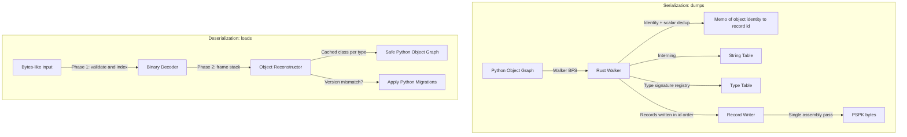

# Rust Engine & PyO3 Architecture

`pysafe-pickle` is built as a compiled Rust cdylib extension module (`_pysafe_pickle`) using PyO3 and Maturin.

The Rust source is small and split by responsibility:

| File | Role |
| :--- | :--- |
| `src/lib.rs` | PyO3 module: `dumps`, `loads`, `dump`, `load`, bytes-like input handling, GIL release for large decodes |
| `src/graph/traversal.rs` | `Walker`: breadth-first object-graph traversal that assigns record IDs and emits records |
| `src/format/mod.rs` | Tag enum, header constants, little-endian and zigzag-varint helpers |
| `src/format/encoder.rs` | `RecordWriter`: string table, type table, record buffer and final assembly into a `bytes` object |
| `src/format/decoder.rs` | Two-phase decoder: validation into a compact index, then object reconstruction |

---

## High-Level Pipeline

---

## 1. Breadth-First Object Traversal (`traversal.rs`)

The `Walker` traverses the Python object graph breadth-first using a work queue:

- **Record IDs are assigned up front.** When a container is written, each child is passed through `assign`, which returns the child's record ID immediately (allocating a new ID and queueing the child if it has not been seen). Records are then written straight into the output buffer in ID order, so no intermediate record tree is ever built. The root is always record 0.
- **Shared and cyclic objects reuse the existing ID.** Non-scalar objects are memoized by identity (address -> record ID) and pinned with a strong reference for the duration of the call so an address can never be reused by a different object. A parent that reaches an already-seen object simply stores that object's record ID. The encoder does **not** emit `Reference` (`0x0E`) records; the tag is only kept so the decoder can read legacy payloads.
- **Scalars are deduplicated by value.** One record each for `None`, `True` and `False`; one record per distinct string (strings under 4096 bytes are interned by value); ints and floats go through a small direct-mapped cache (floats keyed by bit pattern). Ints outside the `i64` range become `BigInt`, strings that are not strict UTF-8 become `StrRaw`.
- **Large payloads are not copied twice.** `bytes` and `str` objects of 4096 bytes or more are referenced in place and copied once, during final assembly, straight into the result `bytes` object.
- **Dataclasses.** Metadata (name, field names from `dataclasses.fields()`, schema version) is cached per type in a bounded process-wide cache, and each type is registered once per call in the type table. Registration is keyed by name *and* field list, so same-named classes with different fields get distinct type IDs.
- **Depth limit.** Traversal depth is capped at the interpreter recursion limit; deeper structures raise `RecursionError` instead of overflowing the native stack.
- **Unsupported types.** Anything that is not one of the supported built-in types or a dataclass (modules, functions, arbitrary class instances, subclasses of built-ins, ...) raises `TypeError: Unsupported type: <name>` before any bytes are produced. Nothing is serialized by calling `__reduce__` or similar hooks.

---

## 2. Writer and Output Assembly (`encoder.rs`)

- The string table and the record section are accumulated in separate buffers and stitched together once, directly into a freshly allocated Python `bytes` object (header, string table, type table, record count, records).
- Writer and walker scratch buffers are recycled per thread (up to a size cap), so repeated `dumps` calls avoid regrowing large allocations.
- The GIL is released only for the final assembly copy, and only when the output is 8 MiB or larger.
- Exceeding the format limits (more than 2^32-1 records or strings, 65535 types, or oversized containers/blobs) raises `ValueError`.

---

## 3. Two-Phase Decoder (`decoder.rs`)

**Phase 1: `decode` (pure Rust).** Validates the whole payload once and builds a compact index with one small fixed-size entry per record. Strings stay as slices of the input; container children are not copied but re-read lazily from the input during phase 2. Every count is checked against the number of bytes remaining (so a forged count cannot trigger a huge allocation), and every record, string and type reference is bounds-checked, so phase 2 never sees an invalid index. It also counts how many times each record is referenced. The legacy `PYGR` magic and legacy `Reference` records are still accepted.

**Phase 2: `reconstruct` (needs the GIL).** Builds Python objects with an explicit frame stack rather than native recursion, bounded by the interpreter recursion limit (`RecursionError` beyond it).

- Only records referenced more than once are memoized.
- Shared lists, dicts, sets and dataclass instances are created and memoized *before* their children are decoded, so DAGs and cycles are rebuilt faithfully. A cycle through an immutable `tuple` or `frozenset` raises `ValueError`.
- **Dataclass reconstruction:** the instance is created first with `object.__new__(cls)` (no `__init__` call, pickle semantics), then each field is set with `object.__setattr__`. Because the instance exists before its fields are decoded, self-referencing dataclasses work. Fields missing from a record default to `None`.
- **Per-type class cache:** classes are generated by `pysafe_pickle._reconstruct.make_class`, which returns the same class for the same `(name, field names)`. The Rust side adds a bounded process-wide cache keyed the same way, and resolves each type at most once per `loads` call.
- **Migrations:** if a type's serialized schema version and the class's current version are both non-zero and differ, the decoded fields are passed to the Python-level `apply_migrations` helper in `pysafe_pickle.migrations`. There is no separate Rust migration module.
- **Allowlist:** if `allowlist=` is given to `loads`/`load`, every type name in the type table is checked against it after phase 1 and before any objects are built (`TypeError` if one is missing).

---

## 4. Input Handling and GIL Release (`lib.rs`)

- `loads` accepts any bytes-like object. A `bytes` object is borrowed directly (it is immutable). A `bytearray` is copied into an owned buffer first, and any other buffer (such as a `memoryview`) is copied via `memoryview(...).tobytes()`, because the data could otherwise be mutated while the GIL is released or while Python code runs during reconstruction. Anything else raises `TypeError: a bytes-like object is required, not '<type>'`.
- `load(file)` calls `file.read()` and applies the same rules to the result; `dump(obj, file)` serializes and calls `file.write(...)` once.
- Phase 1 runs with the GIL released when the input is 64 KiB or larger; for smaller inputs the release/re-acquire would cost more than it frees. Phase 2 always holds the GIL.
- `dumps` currently supports only `protocol=5` (the default). `schema_version` is accepted but ignored, and `hmac_key` raises `NotImplementedError` because HMAC signing is not implemented.

---

## 5. ABI3 Wheel Distribution

`pysafe-pickle` targets PyO3's `abi3-py310` feature:
- A single pre-built wheel runs across Python 3.10 through 3.15 (free-threaded builds are not supported) and future Python 3.x minor releases without recompilation.
- Zero local C/Rust compiler requirement for end users.
