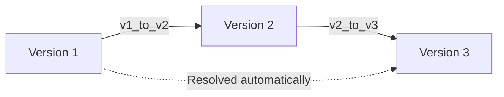

# Schema Evolution & Migrations

In long-running production systems, data models change over time. `pysafe-pickle` gives you the building blocks to handle that:
- Each dataclass can declare its schema version via `__pysafe_pickle_version__`.
- The version is embedded into the binary type table (4 bytes per type).
- Migration functions registered via `@psp.migrate(...)` are stored in a registry, and `psp.apply_migrations(...)` resolves and runs the chain between two versions.

::: warning Current limitation: `loads` does not run migrations for you in normal use
The decoder only runs migrations when the serialized version differs from the version reported by the **loaded** class. But `loads` rebuilds dataclasses as dynamically generated classes that do not carry `__pysafe_pickle_version__`, so the loaded class reports no version and the automatic path is skipped. In practice you call `psp.apply_migrations(...)` yourself, as shown [below](#applying-migrations-explicitly).
:::

---

## Defining Versioned Dataclasses

Assign `__pysafe_pickle_version__` (or the legacy attribute `__pygraph_version__`) to your dataclass. It is a plain class attribute, not a field:

```python
from dataclasses import dataclass
import pysafe_pickle as psp

@dataclass
class User:
    name: str
    age: int
    email: str = ""
    __pysafe_pickle_version__ = 2
```

When an instance of `User` is serialized with `psp.dumps()`, the type table records:
- Type Name: `"User"`
- Fields: `["name", "age", "email"]`
- Schema Version: `2`

Classes without the attribute are stored with version `0` (unversioned). The `schema_version=` argument of `dumps` is accepted but currently ignored; the version always comes from the class attribute.

---

## Registering Migrations

Use the `@psp.migrate` decorator to define migration functions that transform the dictionary state from one version to another. Without `type_name`, the class name is derived from the function's qualified name, so passing `type_name` explicitly is recommended.

```python
import pysafe_pickle as psp

# Migrate User state from Version 1 -> Version 2
@psp.migrate(from_version=1, to_version=2, type_name="User")
def migrate_user_v1_to_v2(state: dict) -> dict:
    """V1 had 'name' + 'age'; V2 added 'email'."""
    state["email"] = "unknown@example.com"
    return state

# Migrate User state from Version 2 -> Version 3
@psp.migrate(from_version=2, to_version=3, type_name="User")
def migrate_user_v2_to_v3(state: dict) -> dict:
    """V2 added 'email'; V3 adds 'phone' and lowercases email."""
    state["phone"] = ""
    state["email"] = state.get("email", "").lower()
    return state
```

### Migration Function Contract

A migration function:
1. Receives `state: dict` containing the field values (a copy; the original is not modified).
2. Modifies or constructs a new `dict`.
3. Returns the transformed dictionary.

`apply_migrations` stamps `__pysafe_pickle_version__` and `__pygraph_version__` on the state after each step, so your function does not need to set them.

---

## Chain Resolution

Given a start and target version, `psp.get_migration_chain(type_name, from_v, to_v)` picks, at each step, the registered migration that starts at the current version and jumps furthest without overshooting the target (a greedy algorithm). If no path exists it raises `ValueError`.



---

## Applying Migrations Explicitly

Because loaded objects are dynamic classes with no version, you need to know which version the data was written with (for example, store it next to the blob or in a database column). Then load, and migrate the state yourself:

```python
from dataclasses import dataclass
import pysafe_pickle as psp

@psp.migrate(from_version=1, to_version=2, type_name="User")
def v1_to_v2(state):
    state["email"] = "unknown@example.com"
    return state

@psp.migrate(from_version=2, to_version=3, type_name="User")
def v2_to_v3(state):
    state["email"] = state["email"].lower()
    state["phone"] = ""
    return state

@dataclass
class User:                      # the class as it was at version 1
    name: str
    age: int
    __pysafe_pickle_version__ = 1

blob = psp.dumps(User("Alice", 30))

old = psp.loads(blob)
print(type(old).__name__, psp.get_schema_version(old))   # User None

state = psp.apply_migrations("User", vars(old), 1, 3)
print(state)
# {'name': 'Alice', 'age': 30, 'email': 'unknown@example.com',
#  '__pysafe_pickle_version__': 3, '__pygraph_version__': 3, 'phone': ''}

# Build your current class from the migrated state
state = {k: v for k, v in state.items() if not k.startswith("__")}
# user = UserV3(**state)
```

Key points:
- `psp.get_schema_version(loaded_obj)` returns `None` for loaded instances, so the serialized version is not exposed to Python; track it yourself.
- Loaded instances are **not** instances of your class. Construct your current class from the migrated dict (`UserV3(**state)`).

### Advanced: enabling the decoder's migration path

The decoder looks up the version on the generated class the first time a type (name plus field names) is loaded in the process. If you create that class yourself first and give it a version, the decoder runs `apply_migrations` during `loads`:

```python
from pysafe_pickle._reconstruct import make_class   # internal API, may change

cls = make_class("User", ["name"])
psp.set_schema_version(cls, 2)        # must happen before the first load of this type
user = psp.loads(blob)                # blob was written at version 1
```

Because the generated class only has the serialized field names, fields **added** by a migration are not regular attributes. They are placed in a dict on the instance as `__pysafe_pickle_extra__` (and `__pygraph_extra__`). Treat this as an internal hook rather than a supported workflow.

---

## Forward Compatibility & Extra Fields

Loaded objects always carry exactly the fields that were serialized, so data written by a newer version of your model is not lost when read by older code: the extra fields simply appear as attributes on the loaded object. Fields that a migration adds beyond the loaded class's fields are stored in `__pysafe_pickle_extra__`, as described above.
