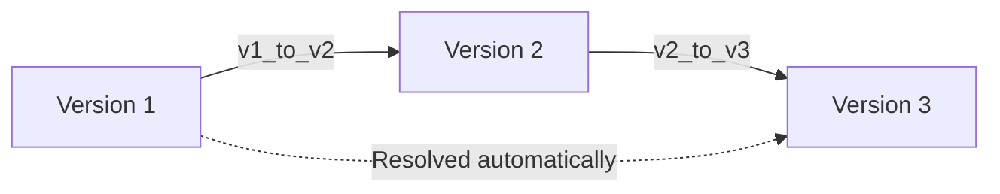

# Schema Evolution & Migrations

In long-running systems, data models change over time. `pysafe-pickle` handles that in three pieces:
- Each dataclass can declare its schema version via `__pysafe_pickle_version__`, which is embedded in the payload's type table.
- Migration functions registered with `@psp.migrate(...)` describe how to turn version N state into version M state.
- When you load with `classes=[YourClass]` and the stored version differs from the class's version, `loads` runs the migration chain and gives you an instance of your current class.

---

## Defining Versioned Dataclasses

Assign `__pysafe_pickle_version__` (or the legacy `__pygraph_version__`) to your dataclass. It is a plain class attribute, not a field:

```python
from dataclasses import dataclass

@dataclass
class User:
    __pysafe_pickle_version__ = 2
    name: str
    age: int
    email: str = ""
```

When an instance of `User` is serialized, the type table records the name `"User"`, the fields `["name", "age", "email"]` and the schema version `2`. Classes without the attribute are stored as version `0` (unversioned). The `schema_version=` argument of `dumps` is accepted but ignored; the version always comes from the class attribute.

---

## Registering Migrations

A migration receives the stored fields as a `dict` (a copy) and returns the new `dict`. Pass `type_name` explicitly: it is the class name the data was **stored** under.

```python
import pysafe_pickle as psp

@psp.migrate(from_version=1, to_version=2, type_name="User")
def user_v1_to_v2(state: dict) -> dict:
    """V1 had 'name' + 'age'; V2 adds 'email'."""
    state["email"] = "unknown@example.com"
    return state

@psp.migrate(from_version=2, to_version=3, type_name="User")
def user_v2_to_v3(state: dict) -> dict:
    """V3 adds 'phone' and lowercases 'email'."""
    state["email"] = state["email"].lower()
    state["phone"] = ""
    return state
```

`apply_migrations` stamps `__pysafe_pickle_version__` and `__pygraph_version__` on the state after each step, so your function does not need to set them.

### Chain Resolution

`psp.get_migration_chain(type_name, from_v, to_v)` picks, at each step, the registered migration that starts at the current version and jumps furthest without overshooting the target (a greedy algorithm). If there is a gap it raises `SchemaVersionError`.



---

## Automatic Migration on Load

Here is the whole flow: data written by version 1 of a class, read by version 3:

```python
from dataclasses import dataclass
import pysafe_pickle as psp

@dataclass
class User:                     # version 1, as it was when the data was written
    __pysafe_pickle_version__ = 1
    name: str
    age: int

old_blob = psp.dumps(User("Alice", 30))

@psp.migrate(from_version=1, to_version=2, type_name="User")
def user_v1_to_v2(state):
    state["email"] = "Alice@Example.com"
    return state

@psp.migrate(from_version=2, to_version=3, type_name="User")
def user_v2_to_v3(state):
    state["email"] = state["email"].lower()
    state["phone"] = ""
    return state

@dataclass
class User:                     # version 3, the class your code uses today
    __pysafe_pickle_version__ = 3
    name: str
    age: int
    email: str = ""
    phone: str = ""

user = psp.loads(old_blob, classes=[User])
print(user)  # User(name='Alice', age=30, email='alice@example.com', phone='')
print(type(user) is User, psp.get_schema_version(user))  # True 3
```

A migration runs when all of these hold:
- the class is passed in `classes=` (on `loads`, `load` or `Unpickler`),
- the stored version and the class's version are both greater than `0`,
- the two versions differ.

After the chain runs, the resulting `dict` is applied to a new instance of your class without calling `__init__`:
- a field missing from the result gets its default (`default` or `default_factory`),
- a field missing without a default raises `TypeError`,
- a key the class does not define raises `TypeError`, so a migration must remove fields that no longer exist,
- a missing chain raises `SchemaVersionError`.

Shared and cyclic references to migrated objects are preserved.

---

## Changes Without a Version Bump

Even without versions, `classes=` tolerates the safe kind of change: **adding a field with a default**. Removing or renaming a field is an error unless a migration handles it:

```python
from dataclasses import dataclass
import pysafe_pickle as psp

@dataclass
class Item:
    name: str
    legacy_code: int

blob = psp.dumps(Item("pen", 7))

@dataclass
class Item:
    name: str
    price: float = 0.0

try:
    psp.loads(blob, classes=[Item])
except TypeError as e:
    print(e)
# Data for 'Item' has field(s) 'legacy_code' that Item does not define; add them or register a @migrate migration
```

Give the class a version (and the old one, if you still can) and register a migration that drops or renames the field.

---

## Renamed Classes

Data is matched to classes by the **stored** class name. If you renamed a class, map the old name to the new class, and register migrations under the old name:

```python
from dataclasses import dataclass
import pysafe_pickle as psp

@dataclass
class Customer:
    __pysafe_pickle_version__ = 1
    name: str

blob = psp.dumps(Customer("Ann"))

@dataclass
class Client:
    __pysafe_pickle_version__ = 2
    name: str
    tier: str = "basic"

@psp.migrate(from_version=1, to_version=2, type_name="Customer")
def customer_to_client(state):
    state["tier"] = "gold"
    return state

print(psp.loads(blob, classes={"Customer": Client}))  # Client(name='Ann', tier='gold')
```

---

## Newer Data, Older Code

If the stored version is **higher** than your class's version (for example during a rolling deploy), no migration function runs. The stored fields are applied as they are, with the same checks: fields your class lacks raise `TypeError`, and fields missing from the data get defaults. Plan downgrades accordingly.

---

## Migrating Without `classes=`

Without `classes=`, dataclasses load as generated stand-in classes with exactly the stored fields and no version, so nothing is migrated (and `psp.get_schema_version(obj)` returns `None`). If you cannot pass your class, track the stored version yourself and call `apply_migrations` on the loaded state:

```python
from dataclasses import dataclass
import pysafe_pickle as psp

@psp.migrate(from_version=1, to_version=2, type_name="Account")
def account_v1_to_v2(state):
    state["balance"] = state.pop("cents") / 100
    return state

@dataclass
class Account:
    __pysafe_pickle_version__ = 1
    owner: str
    cents: int

old = psp.loads(psp.dumps(Account("ann", 1234)))
print(type(old) is Account, psp.get_schema_version(old))  # False None

state = psp.apply_migrations("Account", vars(old), 1, 2)
print(state)
# {'owner': 'ann', 'balance': 12.34, '__pysafe_pickle_version__': 2, '__pygraph_version__': 2}
```

Drop the `__*_version__` keys before building your class from the result.
